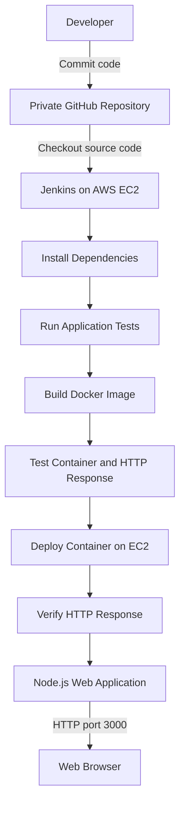

# Jenkins + Docker CI/CD Deployment on AWS EC2

A hands-on DevOps project demonstrating Continuous Integration (CI) and Continuous Deployment (CD) of a Node.js web application using Jenkins, Docker, and AWS EC2.

The pipeline checks out source code from a private GitHub repository, installs dependencies, runs tests, builds a Docker image, validates the application's HTTP response, and deploys the container on an AWS EC2 instance.

## Project Overview

This project demonstrates how to automate the application delivery workflow using Jenkins Pipeline as Code.

### Key Features

- **Jenkins Pipeline:** Defines CI/CD stages using a `Jenkinsfile`.
- **GitHub Integration:** Retrieves source code from a private GitHub repository.
- **Dockerized Application:** Packages the Node.js application into a Docker image.
- **Automated Testing:** Installs dependencies and runs the application's test command.
- **HTTP Validation:** Checks that the container returns HTTP 200 and the expected application content.
- **AWS EC2 Deployment:** Runs the application in a Docker container on an EC2 instance.
- **Container Management:** Replaces the existing application container during deployment.
- **Deployment Verification:** Validates the deployed application's HTTP response.

## Architecture



**Note:** The current workflow can be triggered manually using Jenkins **Build Now**. Automatic GitHub webhook triggering can be added separately.

## Technology Stack

| Technology | Purpose |
|---|---|
| AWS EC2 | Hosts Jenkins and the deployed application |
| Jenkins | Automates CI/CD pipeline stages |
| Git and GitHub | Source control and repository management |
| Docker | Builds and runs application containers |
| Node.js | Application runtime |
| npm | Dependency installation and test execution |
| Linux / Ubuntu | Server operating system |
| HTTP | Application access and response validation |

## CI/CD Workflow

### 1. Source Code Checkout

Jenkins retrieves the application source code from the GitHub repository using the configured Git credentials.

### 2. Environment Verification

The pipeline uses the Node.js 22 Alpine Docker image to verify the Node.js runtime and execute npm commands.

### 3. Dependency Installation

The pipeline runs `npm ci` using the committed `package-lock.json` to install the application's dependencies.

### 4. Application Testing

The pipeline executes:

```bash
npm test
```

The current test script prints `Test passed`. This is a basic demonstration test rather than a comprehensive automated test suite.

### 5. Docker Image Build

Jenkins builds the application image:

```bash
docker build -t jenkins-docker-cicd-deployment:latest .
```

### 6. Container and HTTP Testing

The pipeline starts a temporary test container and validates the HTTP response and expected application content. The test container uses host port `3001`, bound to localhost, to avoid conflicting with the deployed application on port `3000`.

### 7. Deployment to AWS EC2

After the validation stage passes, Jenkins replaces the existing `jenkins-cicd-app` container and starts the new image:

```bash
docker run -d \
  --restart unless-stopped \
  --name jenkins-cicd-app \
  -p 3000:3000 \
  jenkins-docker-cicd-deployment:latest
```

### 8. Deployment Verification

Jenkins sends an HTTP request from inside the running container and verifies that the application returns HTTP 200.

## Application Access

Once the deployment succeeds, access the application at:

```text
http://<EC2-PUBLIC-IP>:3000
```

Replace `<EC2-PUBLIC-IP>` with the public IP address of your EC2 instance.

**AWS Security Group:** Allow inbound TCP port `3000` from your own IP address for testing. Avoid exposing the application publicly unless required.

## Repository Structure

```text
jenkins-docker-cicd-deployment/
├── Jenkinsfile
├── Dockerfile
├── app.js
├── package.json
├── package-lock.json
└── README.md
```

## Prerequisites

- An AWS account with an Ubuntu EC2 instance.
- Jenkins installed and running.
- Docker installed and available to the Jenkins user.
- A GitHub repository containing the application source code.
- Jenkins configured with credentials for the private repository.
- AWS Security Group rules configured for the required access.

## Setup Summary

1. Clone the repository onto your development machine.
2. Configure the Jenkins job to use **Pipeline script from SCM**.
3. Set the repository URL and branch to `main`.
4. Configure the GitHub credentials in Jenkins.
5. Run the pipeline using **Build Now**.
6. Verify that the build, HTTP test, and deployment stages succeed.
7. Open the deployed application using the EC2 public IP and port `3000`.

## Important Implementation Notes

- The current pipeline builds and deploys a Docker image on the same EC2 instance that hosts Jenkins.
- The deployment stage replaces the existing application container; it is not a zero-downtime deployment strategy.
- The current pipeline uses the mutable `latest` image tag.
- The `npm test` command is currently a basic placeholder test.
- GitHub webhook triggering, rollback automation, image registry integration, and production-grade monitoring are not included in the current implementation.

## Future Improvements

- Configure GitHub webhooks for automatic pipeline triggering.
- Publish versioned Docker images to Amazon ECR.
- Add meaningful unit and integration tests.
- Add health checks and deployment rollback.
- Implement safer deployment strategies.
- Separate the Jenkins controller from the application host.
- Add HTTPS using a reverse proxy and TLS certificate.
- Integrate monitoring, logging, and notifications.

## Learning Outcomes

Through this project, I gained hands-on experience with:

- Jenkins declarative pipelines and pipeline stages.
- GitHub source control integration.
- Docker image creation and container lifecycle management.
- Node.js application containerization.
- Automated application validation.
- Deploying a containerized application on AWS EC2.
- Troubleshooting CI/CD execution and deployment issues.

## Author

**Amritanshu Ranjan**

- GitHub: [Amritanshu04](https://github.com/Amritanshu04)
- LinkedIn: [Amritanshu Ranjan](https://www.linkedin.com/in/amritanshu-ranjan-singh/)

